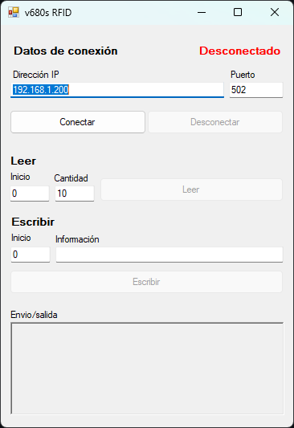

# V680S RFID Modbus Client

**Desktop application to read and write RFID tags on an Omron V680S industrial reader over Modbus TCP.**

<p align="center">
  
</p>

V680S RFID Modbus Client was developed as a professional proof of concept to demonstrate the integration of industrial RFID hardware with custom software. It is a Windows desktop application that integrates an **Omron V680S** industrial RFID reader/writer with custom software through **Modbus TCP**, one of the most widely used communication protocols in industrial automation. It allows reading the data stored on an RFID tag, writing new information to it and inspecting every frame exchanged with the device in real time.

This kind of integration is common on production lines, where RFID tags travel with each product or pallet to store traceability information that machines and control systems can read and update at every station.

## Highlights

- **Industrial protocol integration.** Communicates with the reader over Ethernet using Modbus TCP, the same protocol used by PLCs, HMIs and SCADA systems.
- **Tag reading.** Reads the tag memory as holding registers and decodes the result to both hexadecimal and ASCII.
- **Tag writing.** Converts text entered by the user into 16-bit registers and writes it to the tag memory.
- **Frame monitor.** Shows the raw Modbus frames sent (Tx) and received (Rx), which makes commissioning and troubleshooting the communication easier.
- **Connection management.** Live connection status and controls that are only enabled while the reader is connected.

## How it works

```
┌──────────────────────┐        Modbus TCP / Ethernet        ┌──────────────────────┐       RF        ┌───────────┐
│  Desktop application │ ──────────────────────────────────▶ │   Omron V680S RFID   │ ─────────────▶ │  RFID tag │
│   (C# · WinForms)    │ ◀────────────────────────────────── │    reader / writer   │ ◀───────────── │           │
└──────────────────────┘     holding registers (FC03/FC16)   └──────────────────────┘                └───────────┘
```

### Reading a tag

1. The user sets the start address and the number of registers to read.
2. The application sends a **Read Holding Registers** request (function code `03`). The quantity is limited to 123 registers, the maximum allowed by the Modbus specification for a single request.
3. The response payload is extracted from the frame and displayed in hexadecimal and converted to ASCII text.

### Writing to a tag

1. The user sets the start address and the information to store.
2. The text is encoded into bytes and grouped into 16-bit words (two characters per register).
3. The application sends a **Write Multiple Registers** request (function code `16`) to store the data on the tag.

### Frame monitor

Every transaction is logged in the output panel:

```
Tx: 00 01 00 00 00 06 FF 03 00 00 00 0A
Rx: 00 01 00 00 00 17 FF 03 14 48 4F 4C 41 ...
Rx payload (Hex): 48-4F-4C-41-...
Rx payload (ASCII): HOLA...
```

## Default configuration

| Parameter | Value |
| --- | --- |
| IP address | `192.168.1.200` |
| Port | `502` (standard Modbus TCP port) |
| Unit identifier | `255` |

The IP address and port can be changed from the interface before connecting.

## Tech stack

- C# · .NET Framework 4.7.2
- Windows Forms
- [EasyModbusTCP](https://github.com/rossmann-engineering/EasyModbusTCP.NET) – Modbus TCP client
- Omron V680S RFID reader/writer (Ethernet)

## Getting started

Requirements: Windows, Visual Studio 2019 or later with the *.NET desktop development* workload, and an Omron V680S reader connected to the same network.

1. Clone the repository:

   ```bash
   git clone https://github.com/Alejandro095/v680s-rfid.git
   ```

2. Open `v680s-RFID.sln` in Visual Studio. The EasyModbusTCP package is restored automatically through NuGet.

3. Build and run the project (`F5`).

4. Enter the reader's IP address and port, press **Conectar** and use the **Leer** and **Escribir** sections to work with the tag.

Make sure the computer is on the same subnet as the reader (for example, `192.168.1.x` for the default address).

## Author

**Javier Alejandro Monsivais Tovar**
